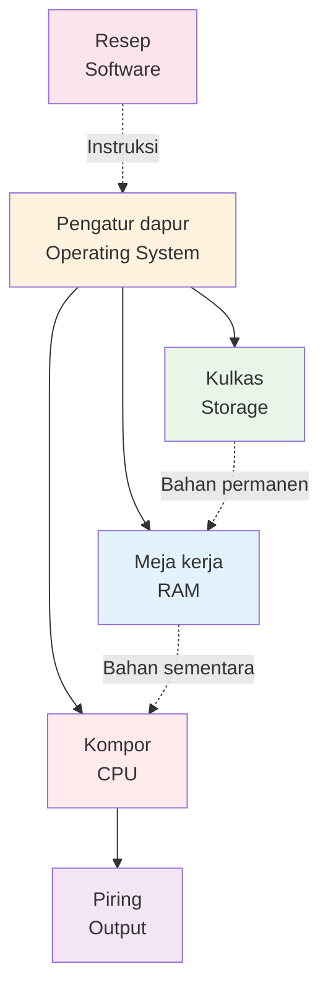

## Komputer Itu Apa

*Foto oleh [Kari Shea](https://unsplash.com/@karishea) di [Unsplash](https://unsplash.com)*

Komputer adalah mesin yang bisa menyimpan data, memproses data, dan menampilkan hasilnya dengan sangat cepat. Itu intinya.

### Analogi Dapur

Bayangin lu lagi masak nasi goreng:

- **Bahan (data)**: nasi, telur, bumbu. Ini yang mau diolah.
- **Kompor dan wajan (CPU)**: alat buat ngolah bahan.
- **Kulkas (storage)**: tempat nyimpen bahan buat jangka panjang.
- **Meja kerja (RAM)**: tempat naruh bahan yang lagi dipakai sekarang.
- **Piring (output)**: hasil masakan yang siap disajikan, yaitu tampilan di layar.
- **Resep (software)**: instruksi cara masaknya.
- **Pengatur dapur (sistem operasi)**: yang ngambil bahan dari kulkas, naruh di meja, dan nyalain kompor pada waktu yang pas.

Komputer kerja persis begitu, cuma jauh lebih cepat. Dia bisa ngerjain miliaran langkah dalam satu detik.

*Diagram: komponen komputer dengan analogi dapur*

<figure><figcaption><em>CPU, RAM, dan storage dijelasin lewat analogi dapur</em></figcaption></figure>

Coba perhatikan: kalau lu hapus salah satu bagian, dapurnya nggak bisa jalan. Kompor tanpa bahan nggak ada gunanya. Bahan tanpa resep nggak jadi apa-apa.
