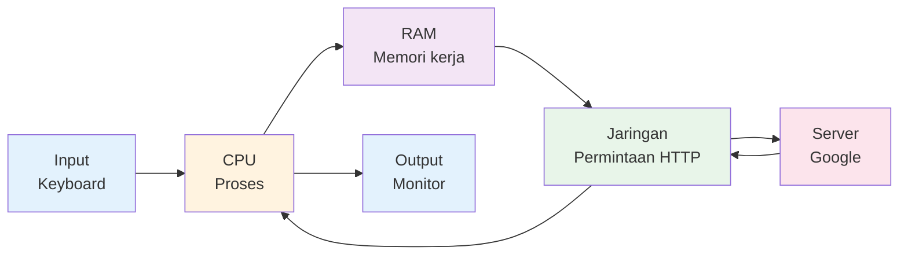

## Workflow: Dari Ketik Sampai Muncul di Layar

Kita gabungin semuanya lewat satu contoh: lu buka Chrome, ketik `google.com`, lalu tekan Enter.

### Urutan Kejadiannya (Disederhanakan)

1. **Input**: lu ngetik di keyboard. OS mendeteksi tombol yang ditekan dan meneruskannya ke Chrome.
2. **Chrome minta sumber daya**: Chrome bilang ke OS, "Aku butuh RAM buat nampung halaman ini." OS ngasih jatah RAM.
3. **Ambil data**: Chrome kirim permintaan lewat jaringan ke server Google. Server balas dengan HTML, CSS, dan JavaScript.
4. **CPU kerja**: CPU baca struktur halaman, ngitung tata letak, dan ngejalanin JavaScript.
5. **GPU kerja** (kalau ada): gambar dan video diubah jadi piksel buat ditampilkan.
6. **Output**: monitor nampilin halaman Google.

Semua itu biasanya selesai dalam hitungan detik, atau kurang.

*Diagram: alur komputer saat lu buka google.com*

<figure><figcaption><em>Input, proses, jaringan, lalu output</em></figcaption></figure>

### Coba Perhatikan

- Semua langkah ini jalan otomatis. Lu cuma ngetik dan tekan Enter.
- Hardware yang lebih cepat bikin tiap langkahnya lebih cepat, dan itu yang lu rasain sebagai komputer yang "ngebut".
- Langkah ke-3 (jaringan) dibahas lebih dalam di Lesson 4, dan langkah ke-4 (browser mengolah halaman) di Lesson 5.
